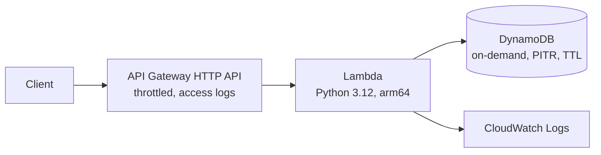

# Serverless Link Shortener

A URL shortener on AWS serverless: an HTTP API in front of one Lambda function and one DynamoDB table, all defined in Terraform. There is no VPC and no always-on database, so it costs nothing while idle and scales with traffic.

It is small on purpose. The goal is to show a serverless API done carefully: atomic data operations, least-privilege IAM, input validation, safe logging and infrastructure that is checked in CI.

## What it does

```bash
# Create a link (needs the bearer token)
curl -X POST "$API_URL/links" \
  -H "Authorization: Bearer $CREATE_TOKEN" -H 'Content-Type: application/json' \
  -d '{"url":"https://example.com/a/very/long/path","slug":"docs","expiresInDays":30}'

# Visit it: 302 redirect, and the visit is counted
curl -i "$API_URL/docs"

# See how it is doing, without counting a visit
curl "$API_URL/links/docs"
```

| Method | Path | Auth | Purpose |
|---|---|---|---|
| `POST` | `/links` | bearer token | Create a link. Body: `url` (required), `slug` (optional), `expiresInDays` (optional, 1 to 365). Returns `201`, or `409` if a custom slug is taken. |
| `GET` | `/{slug}` | public | `302` redirect to the destination and count the visit. |
| `GET` | `/links/{slug}` | public | URL, creation time, expiry and click count. |

Without a custom slug, a random 7-character slug is generated.

## Architecture



| Resource | Notes |
|---|---|
| API Gateway HTTP API | Three routes, default stage throttled to 10 requests/s with a burst of 20 (both configurable). Access logs omit IP addresses. |
| Lambda | One function, `arm64`, 128 MB, 5 s timeout. |
| DynamoDB | On-demand billing, encryption at rest, point-in-time recovery, TTL on `expiresAt`, deletion protection on. |
| IAM | `PutItem`, `GetItem` and `UpdateItem` on this one table, and log writes to this function's own log group. Nothing else. |
| CloudWatch Logs | Managed log groups with a retention period (14 days by default). |

## Design decisions

- **One atomic request per operation.** Creating a link is a conditional `PutItem` that cannot overwrite an existing slug. A visit is a single conditional `UpdateItem` that adds one click and checks the link exists and has not expired in the same request, so concurrent visits are all counted and an expired link cannot be counted.
- **Expiry is enforced twice.** DynamoDB's TTL removes expired items, but that can lag by hours, so the redirect and stats paths check `expiresAt` themselves.
- **The logic never touches AWS directly.** A small store interface has a DynamoDB implementation and an in-memory one, so the whole service is tested without AWS libraries or credentials.
- **Safe by default.** Only absolute `http` and `https` URLs are accepted, with no embedded credentials. Slugs use a restricted alphabet and a reserved word cannot shadow a route. Request bodies are capped at 4 KB.
- **Quiet logs.** The per-request log line records only the method, a route label such as `/{slug}` and the status, never the token, request bodies, URLs or slugs. Unexpected errors are logged with a stack trace for debugging, so treat that error log as sensitive.
- **Errors do not leak.** Unexpected failures return `{"error":"internal error"}` and the detail goes only to the logs.

## Deploy

Requires Terraform 1.6 or later and AWS credentials for an account you control.

```bash
export TF_VAR_create_token="$(openssl rand -hex 24)"   # keep this safe: it authorises link creation
cd terraform
terraform init
terraform apply
```

`terraform output api_url` prints the base URL. To remove everything, set `table_deletion_protection = false`, apply, then run `terraform destroy`.

## Tests and checks

```bash
python -m unittest discover -s tests -v     # 65 tests, standard library only
```

CI runs on every push:

| Job | What it checks |
|---|---|
| Unit tests | The 65 tests, plus a compile check of the Lambda sources. |
| Terraform | `terraform fmt -check`, `terraform init -backend=false` and `terraform validate`. |
| Security | A Trivy configuration scan of `terraform/`, failing on `HIGH` or `CRITICAL` findings. The action is pinned to a commit. |

## Limits and trade-offs

- **Not deployed from this repository.** The Terraform passes `fmt`, `validate` and the security scan, and the application code is fully tested, but the stack has not been applied to a live AWS account here. Expect to adjust it on first deploy.
- **The creation token is a shared secret in a Lambda environment variable.** It is encrypted at rest and not logged, but anyone who can read the function's configuration can read it. For real use, move it to Secrets Manager or put a proper authorizer, such as Cognito or IAM, in front of `POST /links`.
- **Anyone can read and follow links.** That is the point of a shortener, but a service that redirects to arbitrary URLs can be misused, so keep the creation token private.
- **No update or delete endpoint, no custom domain and no analytics beyond a click count.** These are natural next steps.
- **A visit counter is a hot item.** A single viral link updates one DynamoDB item per click, which is fine at this scale but is the first thing to revisit for very high traffic.

## Layout

```
app/
  handler.py      Lambda entry point: routing, auth, request parsing
  service.py      link creation, resolving and stats
  store.py        DynamoDB store and in-memory store
  validation.py   URL, slug and expiry validation
tests/            65 tests with no AWS dependency
terraform/        DynamoDB, Lambda and IAM, API Gateway, variables and outputs
.github/          CI workflow and Dependabot
```

## License

MIT. See `LICENSE`.
